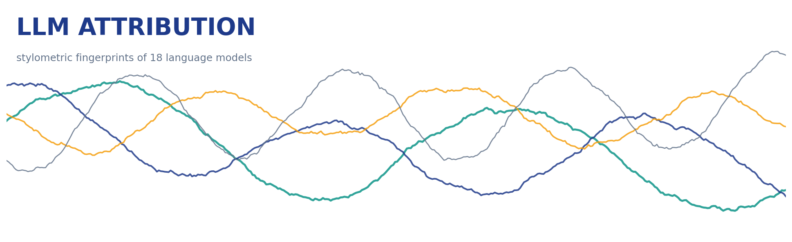
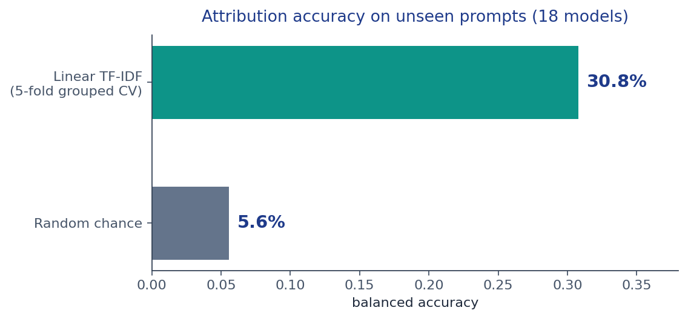
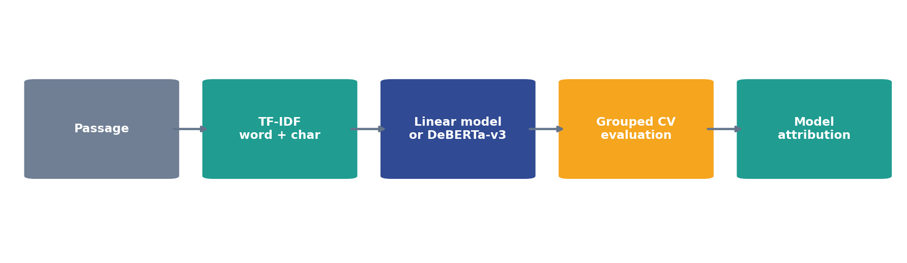
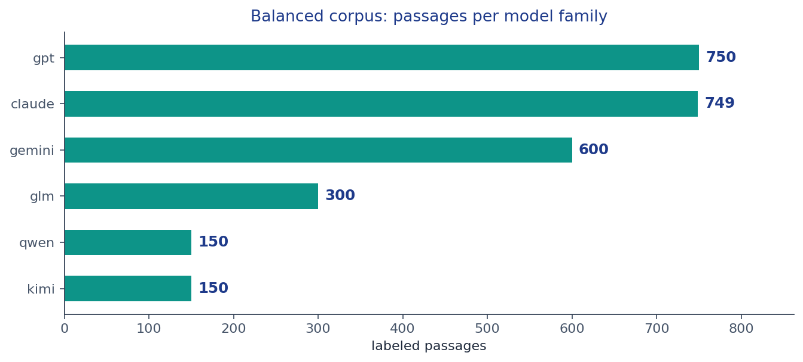
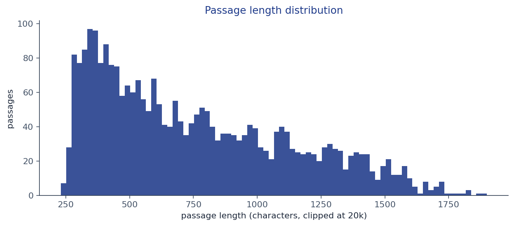

# LLM Attribution

Identify which large language model wrote a piece of text.

LLM Attribution is a text-classification toolkit that attributes an unseen
passage to one of 18 large language model families (GPT, Gemini, Claude,
Qwen, GLM, Kimi, and more) using stylometric signals. It ships two model
tracks - a fast linear TF-IDF baseline and a DeBERTa-v3 fine-tuning track -
plus a leakage-safe evaluation harness.



## Why it matters

As AI-generated text blends into everyday writing, knowing *which* model
produced a passage supports content auditing, benchmark integrity, dataset
curation, and misuse investigation. Different models leave different
fingerprints - punctuation habits, formatting quirks, vocabulary tics - and
those fingerprints are learnable.

## Results



Balanced accuracy from 5-fold prompt-grouped cross-validation on a corpus
of 2,699 labeled passages spanning 18 models (~150 passages per model).
Grouping by prompt keeps every prompt entirely inside one fold, so the
score measures attribution of *unseen* prompts rather than memorized
context. Random chance on 18 balanced classes is 5.6%.

## How it works



1. **Features** - a union of word-level (1-2 gram) and character-level
   (3-5 gram) TF-IDF captures both topical wording and model-specific
   writing quirks.
2. **Linear track** - multinomial logistic regression over the TF-IDF
   union trains in minutes on a CPU.
3. **Transformer track** - DeBERTa-v3 fine-tuned with KerasHub (torch
   backend) for deeper sequential signals; runs fully offline once the
   model preset is local.
4. **Evaluation** - `GroupKFold` cross-validation with balanced accuracy,
   so class balance and prompt leakage are both handled correctly.

## Data exploration

The training corpus is balanced by construction: ~150 passages for each of
the 18 models.



Passage lengths vary widely - from one-line answers to multi-thousand-word
essays - which is exactly why character-level features matter: long-form
formatting habits carry a strong signal.



## Quickstart

```bash
pip install -r requirements.txt
python -m llm_attribution.train \
    --data your_corpus.csv \
    --text-col text --label-col model --group-col prompt_id
```

`your_corpus.csv` needs one row per passage with a text column and a model
label column; a group column (e.g. prompt id) enables leakage-safe CV.
Then open `notebooks/attribution_workflow.ipynb` for the full explained
workflow from EDA to both model tracks.

## Repository layout

```
src/llm_attribution/   importable package (features, models, evaluation)
notebooks/             full explained workflow notebook
assets/                README graphics
```

## License

Apache-2.0 - Copyright 2026 Parth Maniar
